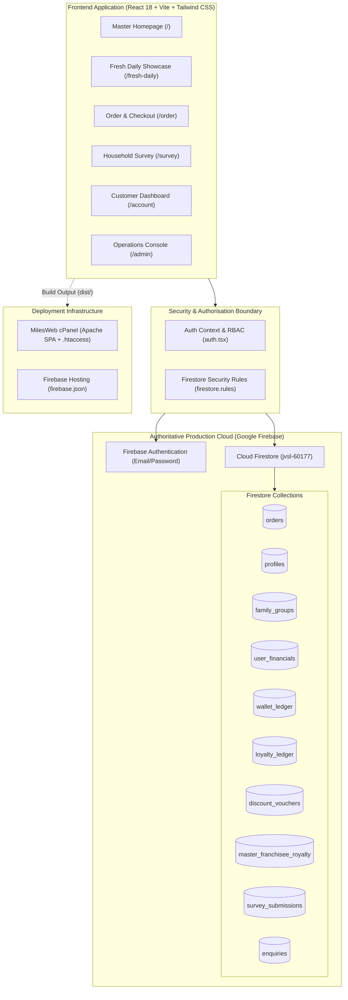
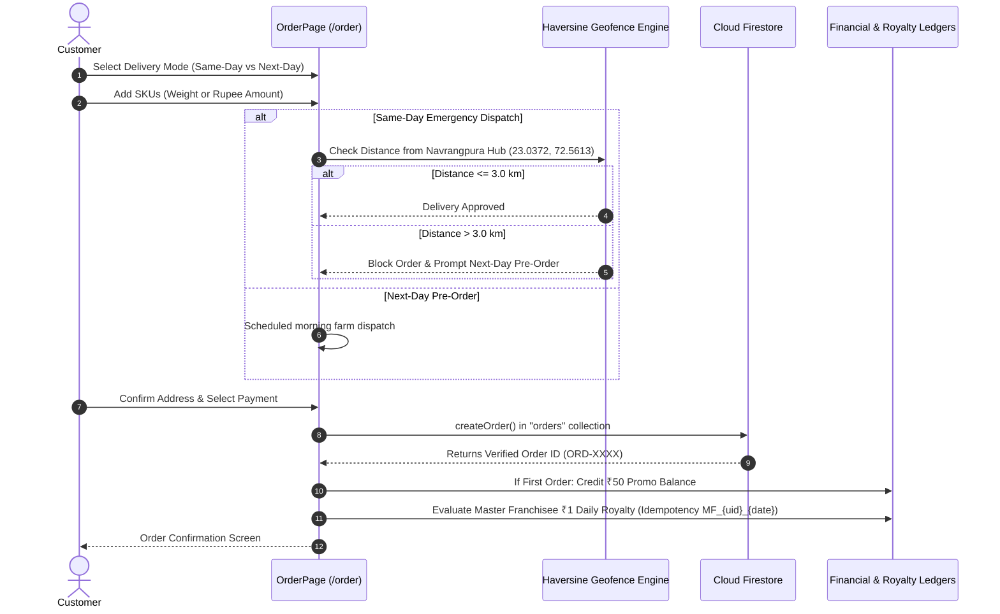
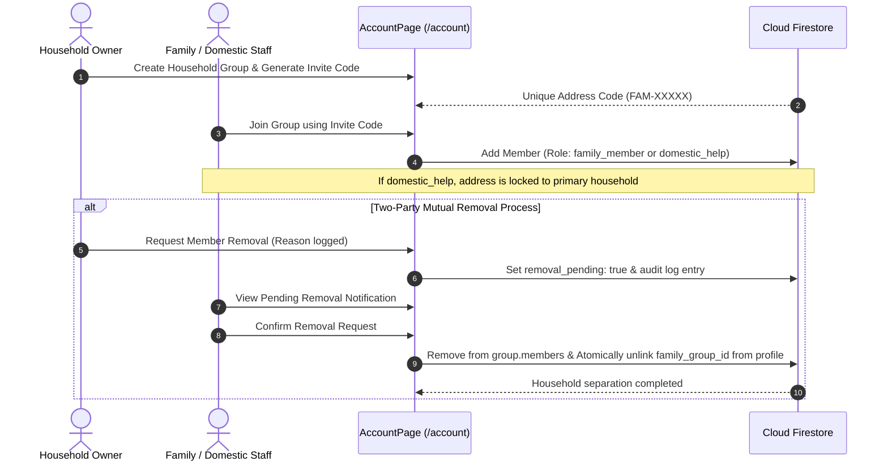
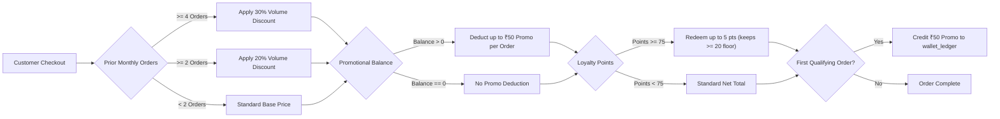

# Jagatpati Vigneshwara LSD LLP (JVLSD)
### Enterprise Farm-to-Table, Household Procurement & Franchise Ecosystem
**Brand Assurance:** TRUST · QUALITY · FAIRNESS  
**Registered Corporate Office:** 4-D, Fourth Floor, Vardan Tower, Lakudi Talav, Near Sardar Patel Stadium, Navrangpura, Ahmedabad – 380009, Gujarat, India.  
**Contact:** `9687660707` · `9099031707` · `9313031079` | `contact@jvlsd.in`  

---

## 1. Executive Overview

**Jagatpati Vigneshwara LSD LLP (JVLSD)** is the parent organization operating an integrated household and commercial food ecosystem. The platform bridges local agricultural procurement, scheduled early-morning household distribution, and automated franchise royalty accounting.

### Core Business Verticals
1. **JVLSD Master Corporate:** Governance, corporate philosophy, family hub coordination, and customer finance management.
2. **JVLSD-FD (Fresh Daily):** Farm-to-table consumer delivery framework operating as a franchisee of Shakhwala, delivering seasonal vegetables, fruits, and pure A2 Gir Cow Milk.
3. **SHAKHWALA Operations:** Vendor procurement, morning packing sheets, inventory planning, and order preparation.
4. **JVLSD-Bites (Future Vertical):** Baked snacks, khakhra, toast, cookies, nuts, and seeds.

---

## 2. System Architecture & Tech Stack



---

## 3. Key Workflows & Functional Diagrams

### 3.1 Order Placement & Delivery Validation Workflow



---

### 3.2 Family Group & Mutual Removal Workflow



---

### 3.3 Financial, Discount & Ledger Engine



---

## 4. Financial & Business Rules Reference Table

| Rule | Parameter | Implementation |
| :--- | :--- | :--- |
| **Initial Wallet Load** | Minimum ₹1,000 | Enforced in `reloadUserWallet()`. Initial top-up must be ≥ ₹1,000. |
| **Subsequent Wallet Reload** | > ₹300 | Once balance reaches ₹300, subsequent reload must be > ₹300. |
| **First-Order Promo Bonus** | ₹50 Credit | Automatically awarded upon confirmation of the 1st qualifying order. |
| **Volume Tier 1 Discount** | 20% OFF | Applied when user has placed ≥ 2 non-cancelled orders in calendar month. |
| **Volume Tier 2 Discount** | 30% OFF | Applied when user has placed ≥ 4 non-cancelled orders in calendar month. |
| **Discount Refund Vouchers** | ₹200 Voucher | Valid for exactly 60 days (2 months) from issuance; tracked in `discount_vouchers`. |
| **Master Franchisee Royalty** | ₹1 / Member / Day | Exactly ₹1 per active subscribed member per qualifying day (`MF_{member_id}_{date}`). |
| **Same-Day Dispatch Radius** | ≤ 3.0 km | Strict Haversine formula calculation relative to Navrangpura Hub (`23.0372, 72.5613`). |
| **Loyalty Point Value** | 1 pt = ₹1 | Minimum qualifying threshold: 75 pts; max redemption: 5 pts/bill; minimum retention floor: 20 pts. |

---

## 5. Directory Structure

```text
jvsld-main/
├── docs/
│   └── TECHNICAL.md              # Detailed Firestore architecture and schema
├── public/
│   ├── .htaccess                 # Apache mod_rewrite SPA routing & security headers
│   └── favicon.ico               # Approved master brand icon
├── src/
│   ├── components/               # Navbar, Footer, UI wrappers
│   ├── data/
│   │   └── companyConfig.ts      # Centralized registered office, phones, and emails
│   ├── lib/
│   │   ├── auth.tsx              # Firebase Auth context & hardened RBAC
│   │   ├── firebase.ts           # Firebase SDK initialization
│   │   ├── firestoreService.ts   # Firestore CRUD, ledgers, and business calculations
│   │   ├── mockData.ts           # Demarcated sandbox testing accounts
│   │   └── router.ts             # Client-side router
│   ├── pages/
│   │   ├── AboutPage.tsx         # Corporate history, purpose, and governance
│   │   ├── AccountPage.tsx       # Customer hub, order history, and family management
│   │   ├── AdminPage.tsx         # Operations dashboard, packing sheets, and royalty ledger
│   │   ├── ContactPage.tsx       # Office details and contact form
│   │   ├── FreshDailyPage.tsx    # Farm-to-table showcase and produce preview
│   │   ├── HomePage.tsx          # Master corporate portal
│   │   ├── LoginPage.tsx         # Registration wizard and authentication
│   │   ├── OrderPage.tsx         # Retail catalogue, cart, geofence, and checkout
│   │   ├── PrivacyPage.tsx       # Privacy policy
│   │   ├── ShakhwalaPage.tsx     # Franchise & vendor portal
│   │   ├── SurveyPage.tsx        # Household kitchen questionnaire
│   │   └── TermsPage.tsx         # Legal terms aligned with client financial rules
│   ├── App.tsx                   # Main application router
│   └── main.tsx                  # Application bootstrap
├── firebase.json                 # Firebase Hosting & Firestore deployment rules
├── firestore.indexes.json        # Firestore composite indexes
├── firestore.rules               # Firestore security access control rules
├── package.json                  # Dependencies & scripts
├── tailwind.config.js            # Design system & color palette
├── tsconfig.json                 # TypeScript compiler configuration
└── vite.config.ts                # Vite build pipeline
```

---

## 6. Local Development & Deployment Instructions

### 6.1 Prerequisites
- **Node.js:** v20+ or v24+
- **Package Manager:** `npm`

### 6.2 Setup & Run Locally
```bash
# Clone the repository
git clone <repository-url>
cd jvsld-main

# Install dependencies
npm install

# Start local development server
npm run dev
```

### 6.3 Quality Verification
```bash
# Verify TypeScript compilation (0 errors required)
npx tsc --noEmit

# Compile production bundle
npm run build
```

### 6.4 Production Deployment
- **MilesWeb (cPanel Shared / VPS):**
  1. Build the production bundle: `npm run build`.
  2. Upload contents of `dist/` into `public_html/` on MilesWeb cPanel via File Manager or FTP.
  3. Ensure `dist/.htaccess` is present in `public_html/` to support SPA URL routing and security headers.
- **Firebase Hosting:**
  ```bash
  firebase deploy --only hosting,firestore
  ```

---

## 7. Handover Checklist & Governance
- [x] Master Gold Seal logo & verified brand colors retained.
- [x] Firestore security rules hardened (unauthorized privilege escalation blocked).
- [x] Dual-write conflicts removed (Google Cloud Firestore is authoritative single backend).
- [x] Default fake balances removed; unauthenticated visitors start at ₹0.
- [x] Haversine 3.0 km same-day dispatch geofencing operationalized.
- [x] Tiered 20% and 30% monthly discounts verified.
- [x] ₹200 discount refund vouchers with 60-day expiry engine implemented.
- [x] Master Franchisee ₹1 daily royalty ledger with CSV export operationalized.
- [x] Clean TypeScript typecheck (`tsc --noEmit`) and production build (`vite build`).

